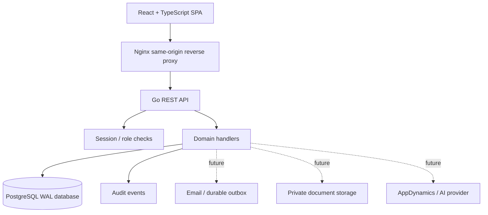

# Architecture overview

The Go backend is organized as a thin HTTP layer with a store/repository boundary. PostgreSQL uses foreign keys, WAL and a 5-second busy timeout. The embedded migration is run on startup, and the first empty database receives fictional demo data. The UI consumes the versioned REST API and uses an HTTP-only session cookie; the login response includes user metadata but the frontend does not store the token in browser storage.

The current approval flow is intentionally narrow: leave requests can be submitted by employee-linked users and approved/rejected by permitted HR/admin/manager roles; a user cannot decide their own request. It is not yet a generic workflow engine. Add organization-level scoping and field-level authorization before using multi-tenant or sensitive data.

## Shift management

Shift templates are stored in `shifts` and include a name, start/end times, unpaid break minutes, grace minutes, configured workdays, and active status. Assignments are stored separately in `shift_assignments` and reference an employee, shift template, and calendar date. A unique constraint on `(employee_id, shift_date)` prevents assigning an employee to multiple shifts on the same date. The API exposes authenticated `GET/POST /api/v1/shifts`, `GET/POST /api/v1/shift-assignments`, and `DELETE /api/v1/shift-assignments/{id}` routes. Template creation is limited to Super Admin, HR Admin, and Shift Supervisor roles; assignments are limited to Super Admin, HR Admin, Department Manager, and Shift Supervisor roles. All creation/removal actions are audited.
